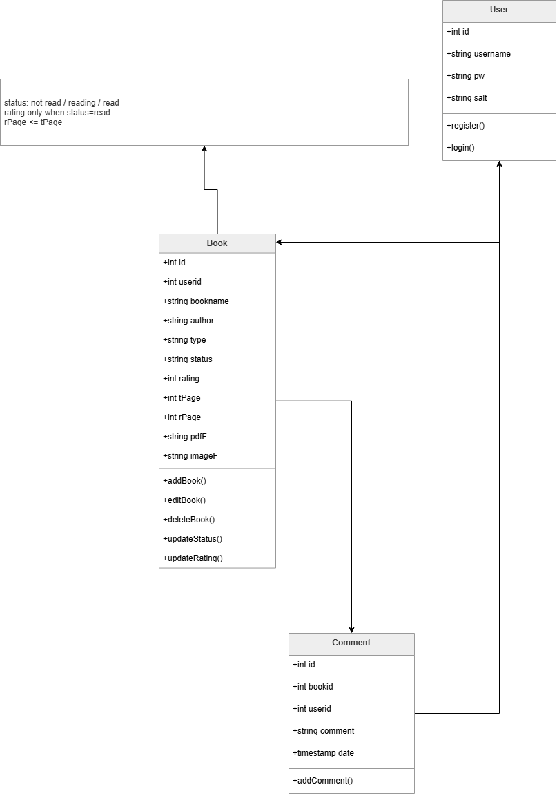
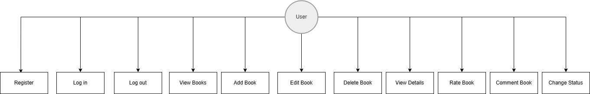

# Simple Personal Library Management System

## Features

- User registration & login (passwords hashed with salted SHA256)
- Add books with optional PDF and cover image uploads
- List, search, filter (by status), and sort books (newest/oldest, name A-Z/Z-A, author, rating, progress)
- Book detail page:
  - Update reading status (not read / reading / read)
  - Rate books (1–10, only when status is "read",otherwise rating is null)
  - Add and view comments
  - Edit book information
- Delete books

## User Stories

- As a new user, I want to register so that I can create my own library.
- As a registered user, I want to log in so that I can access my personal books.
- As a user, I want to log out so that my session ends securely.
- As a user, I want to add a new book with title, author, type, total pages and optionally a PDF and cover image so I can keep full details.
- As a user, I want to view all my books in one place so that I can see my collection at a glance.
- As a user, I want to search for books by name or author so that I can quickly find a specific book.
- As a user, I want to filter books by status (not read / reading / read) so that I can focus on what I need.
- As a user, I want to sort books by newest, oldest, name, author, rating, or reading progress so that I can organise my library how I like.
- As a user, I want to upload a PDF file with the book so I can read it where ever I am .
- As a user, I want to upload a cover image for the book.
- As a user, I want to rate a book (1–10) so I can recommend the books I loved to my friends.
- As a user, I want to add comments to a book.
- As a user, I want to edit book details (title, author, type, pages, PDF, cover).
- As a user, I want to delete a book from my library so that I can remove books that sold or given.
- As a user, I want to see all comments.

## Cases
### Uml Case Diagram

### Use Case Diagram

## Requirements

- Python 3.8 or higher
- Flask (pip install flask)
- SQLite3 (comes bundled with Python)
